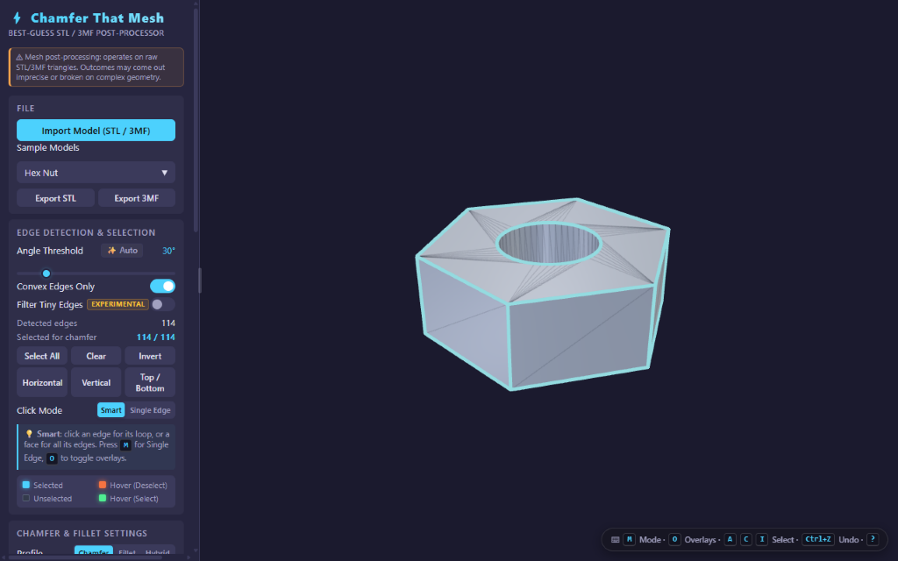
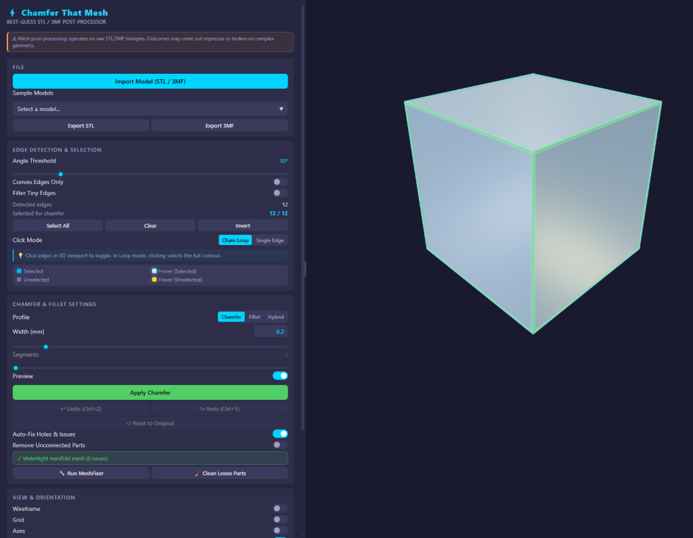
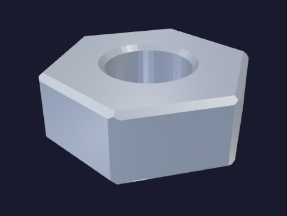
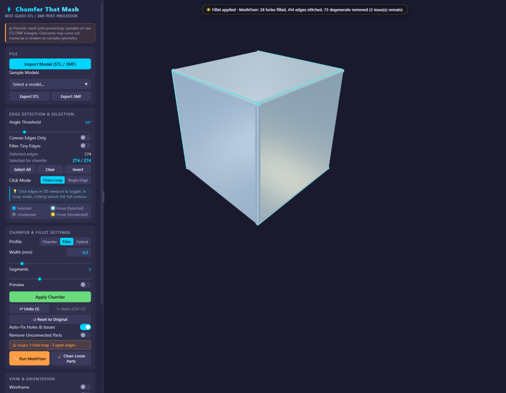
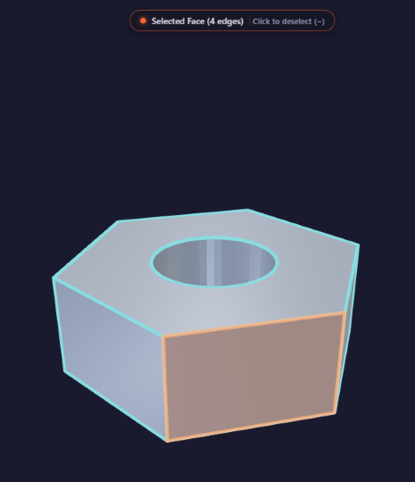
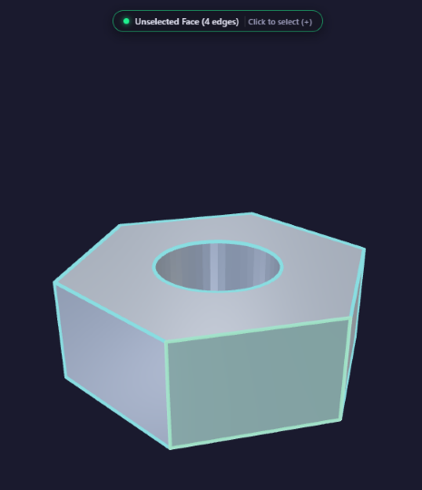
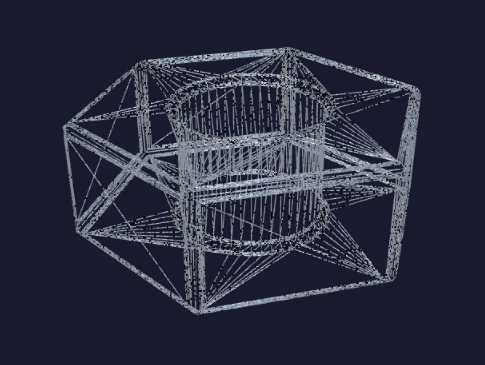
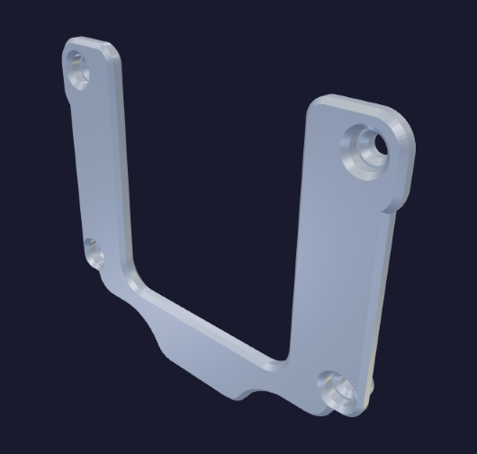
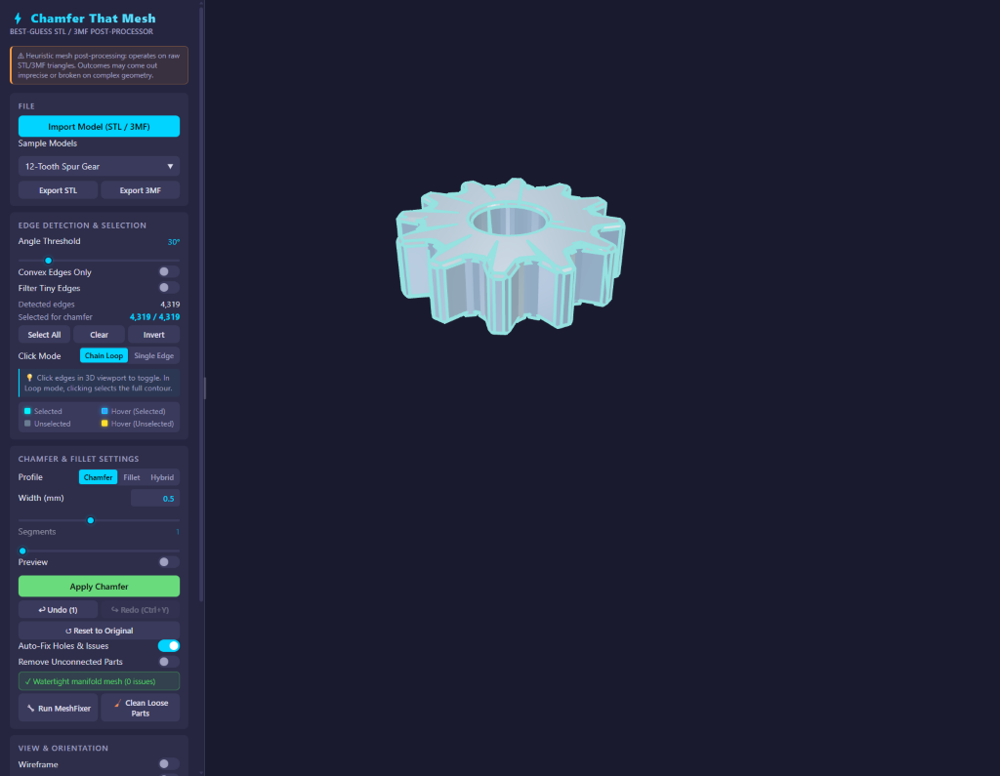
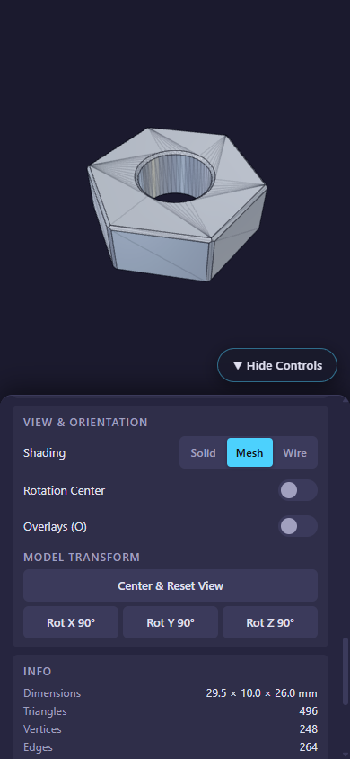

# Chamfer That Mesh

[](https://larsbrockmann.github.io/chamfer-that-mesh/)
[](https://github.com/larsbrockmann/chamfer-that-mesh/wiki)
[](https://github.com/larsbrockmann/chamfer-that-mesh/actions/workflows/deploy.yml)
[](LICENSE)
[](#)
[](https://github.com/elalish/manifold)
[](#)

A browser-based 3D studio for adding watertight chamfers, fillets, and hybrid bevels to STL and 3MF meshes—ideal for 3D printing and mechanical parts when you only have raw triangle geometry without source CAD solids. Everything runs 100% locally in your browser with zero server uploads.



> [!NOTE]
> Powered by the **Manifold-3D WebAssembly** CSG kernel (with `three-bvh-csg` fallback) and the **MeshFix C++ PMP WebAssembly** engine (`meshfix-wasm`), beveled outputs are strictly 2-manifold and watertight (`0` open edges, `0` non-manifold edges) by default.

## Showcase Closeups

| Live Emerald Preview Ribbon | Watertight Flat Chamfer (`45°`) | Smooth Multi-Segment Radial Fillet |
|:---:|:---:|:---:|
|  |  |  |
| *Real-time cutting envelope along closed hex & bore loops* | *Crisp planar cuts with clean 3-way corner miters* | *6-segment cylindrical fillet with smooth specular highlights* |

| Face Hover to Deselect (`−`) | Face Hover to Select (`+`) | Hybrid Bevel Wireframe Topology |
|:---:|:---:|:---:|
|  |  |  |
| *Warm Coral-Orange (`#ff6b38`) previews adjacent edges to remove* | *Bright Emerald (`#1ff08f`) previews edges to add over Graphite (`#333b4d`)* | *Hybrid profile combining a flat center with curved shoulder transitions* |

| Metabo Base Bracket (Complex 3MF) | Precision 12-Tooth Spur Gear | Subtle `Mesh` Base & Mobile Drawer |
|:---:|:---:|:---:|
|  |  |  |
| *`1.0 mm` chamfer across counterbores & U-perimeter (`0` issues)* | *12 involute gear teeth beveled cleanly without spikes* | *Subtle CAD crease & wireframe base in responsive bottom drawer* |

## Features

- **STL & 3MF Import / Export:** Exact **1:1 mm** scale with automatic `.3mf` unit normalization (`micron`, `cm`, `inch`, `foot`, `meter` -> `mm`), plus **36 sample & test-library models** (`3` built-in demo shapes + `33` Test Library models)
- **Smart Edge & Face Detection:** Dihedral angle slider (`0°–180°`), one-click **Auto Angle Threshold** (`✨ Auto`), **Convex Edges Only**, degenerate-triangle filtering for reliable post-chamfer bevel edge detection, and experimental **Filter Tiny Edges** (`Combine` | `Ignore` | `Both` + Min Length)
- **Streamlined Click Modes (`M`):** Toggle between **Smart** (default — clicks edges for tangent-continuous loops or faces for all bordering sharp edges, with front-depth occlusion filtering) and **Single Edge** (individual edge segments only)
- **Intuitive 4-State Semantic Coloring & Layered Rendering:** Electric Cyan (**Selected**), Warm Coral-Orange (**Hover Deselect `−`**), Dark Graphite (**Unselected**), Bright Emerald-Mint (**Hover Select `+`**) rendered in the transparent pass strictly above subtle CAD **Mesh** base wireframe/crease lines, toggleable with **Overlays (`O`)**
- **Three Bevel Profiles:** **Chamfer** (flat 45°), **Fillet** (2–12 segment radial arc), and **Hybrid** (3–12 segment flat-arc blend), with live translucent **Preview** ribbons and dynamically expanding width slider (`0.01–100 mm`)
- **Watertight CSG & Dual-Engine Repair:** Primary **Manifold-3D WebAssembly** CSG with head-to-tail closed loop cutters, **C++ PMP WASM MeshFixer** (`meshfix-wasm`) with watertight passthrough guard & boolean-difference verification, plus **🧹 Clean Parts split button** with crimson 3D loose-part preview (`👁`)
- **Workspace & Inspection:** 14-light CAD inspection rig, **Shading** switcher (**Solid** | **Mesh** *(default)* | **Wire**), origin-locked 360° pole-crossing orbit with **Rotation Center** gimbal visualizer, **20-level Undo/Redo** + **Reset to Original**, `Rot X/Y/Z 90°`, floating shortcuts bar (`?`), and resizable desktop sidebar

## Documentation & Wiki

Full guides and feature closeups are published in the [**Documentation Wiki**](https://github.com/larsbrockmann/chamfer-that-mesh/wiki):

- [**UI Tour & Navigation**](https://github.com/larsbrockmann/chamfer-that-mesh/wiki/UI-Tour-and-Navigation) — Origin-locked 360° orbit navigation, `Rotation Center` visualizer, `Shading` modes (**Solid** / **Mesh** / **Wire**), **Overlays (`O`)**, 14-light inspection rig, resizable sidebar, and mobile bottom sheet.
- [**Edge Detection & Selection**](https://github.com/larsbrockmann/chamfer-that-mesh/wiki/Edge-Detection-and-Selection) — Angle threshold, ✨ Auto detection, degenerate filtering & post-chamfer bevel edges, Filter Tiny Edges, **Smart** vs **Single Edge** picking (`M`), and 4-state hover/click coloring.
- [**Bevel Profiles & Engine**](https://github.com/larsbrockmann/chamfer-that-mesh/wiki/Bevel-Profiles-and-Engine) — Chamfer, Fillet, and Hybrid profiles, layered preview ribbons, and the Manifold-3D CSG kernel.
- [**Mesh Repair & Diagnostics**](https://github.com/larsbrockmann/chamfer-that-mesh/wiki/Mesh-Repair-and-Diagnostics) — C++ WASM MeshFixer, watertight passthrough guard, bool-diff verification, loose-part cleanup, and the 36-model validation suite.
- [**File Formats & Sample Library**](https://github.com/larsbrockmann/chamfer-that-mesh/wiki/File-Formats-and-Sample-Library) — STL/3MF scaling, all **3 built-in demo shapes**, and the **33-model Test Library**.

## Usage

1. Load a model: pick from the **Sample Models** dropdown (**3 built-in demo shapes** or **33 Test Library models**), click **Import Model**, or drag and drop `.stl` / `.3mf` onto the viewport.
2. Adjust **Angle Threshold** (or click **✨ Auto**) and click edges, loops, or faces directly in 3D (**`M`** toggles **Smart** / **Single Edge**; **`O`** toggles **Overlays** to inspect bare geometry over subtle **`Mesh`** base lines).
3. Choose **Chamfer**, **Fillet**, or **Hybrid**, set **Width (mm)** / **Segments**, toggle **Preview** to check cutting envelopes, and click **Apply Chamfer**.
4. Export the watertight result with **Export STL** or **Export 3MF**.

| Shortcut | Action |
|---|---|
| `M` | Toggle Click Mode: **Smart** / **Single Edge** |
| `O` | Toggle Viewport **Overlays** (sharp edges, face hover, preview ribbons) |
| `A` / `Ctrl+A` | Select all detected edges |
| `C` | Clear edge selection |
| `I` | Invert edge selection |
| `Ctrl+Z` / `Cmd+Z` | Undo last bevel, repair, cleanup, or 90° rotation |
| `Ctrl+Y` / `Ctrl+Shift+Z` | Redo |
| `Esc` / `?` | Stop in-progress operation or toggle Shortcuts popover |
| Left-drag / Right-drag / Scroll | 360° origin-locked orbit / Pan / Zoom |

## Development

Requires Node.js 18+.

```bash
npm install
npm run dev      # local dev server
npm run build    # static build in dist/
npm test         # validate all 36 sample & test-library models
```

## Deploying to GitHub Pages

In your repository go to **Settings → Pages** and set **Source** to **GitHub Actions**. The included [deploy.yml](.github/workflows/deploy.yml) workflow builds and publishes the site on every push to `main`.

## Built with

- [Manifold-3D (`manifold-3d`)](https://github.com/elalish/manifold)
- [MeshFix WASM (`meshfix-wasm`)](https://github.com/larsbrockmann/meshfix-wasm)
- [Three.js](https://threejs.org/)
- [three-bvh-csg](https://github.com/gkjohnson/three-bvh-csg)
- [fflate](https://github.com/101arrowz/fflate)
- [Vite](https://vitejs.dev/)

## License

[MIT](LICENSE)
