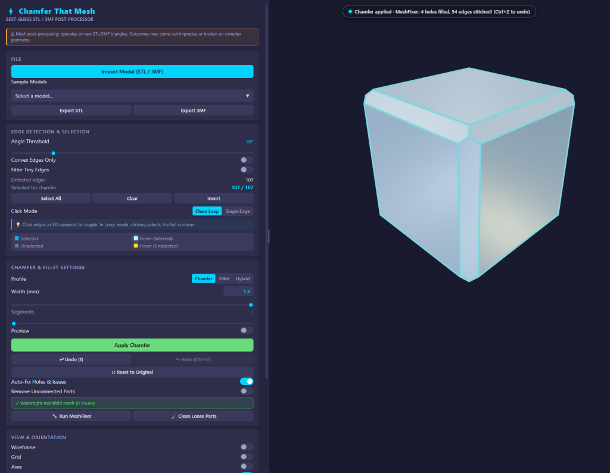
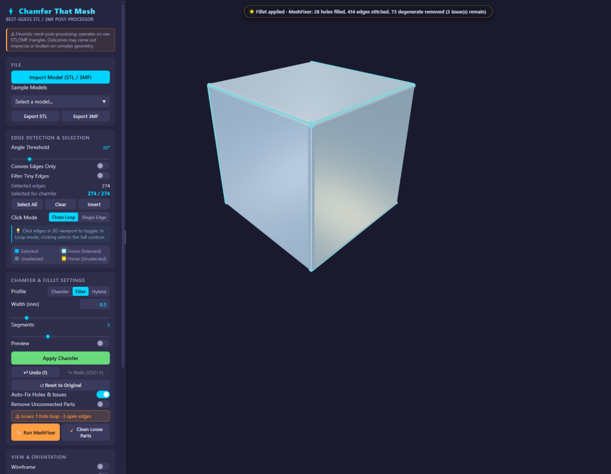
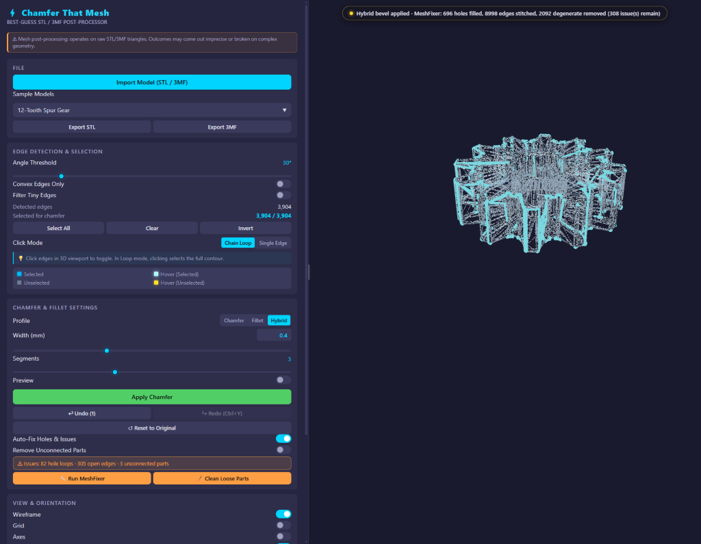
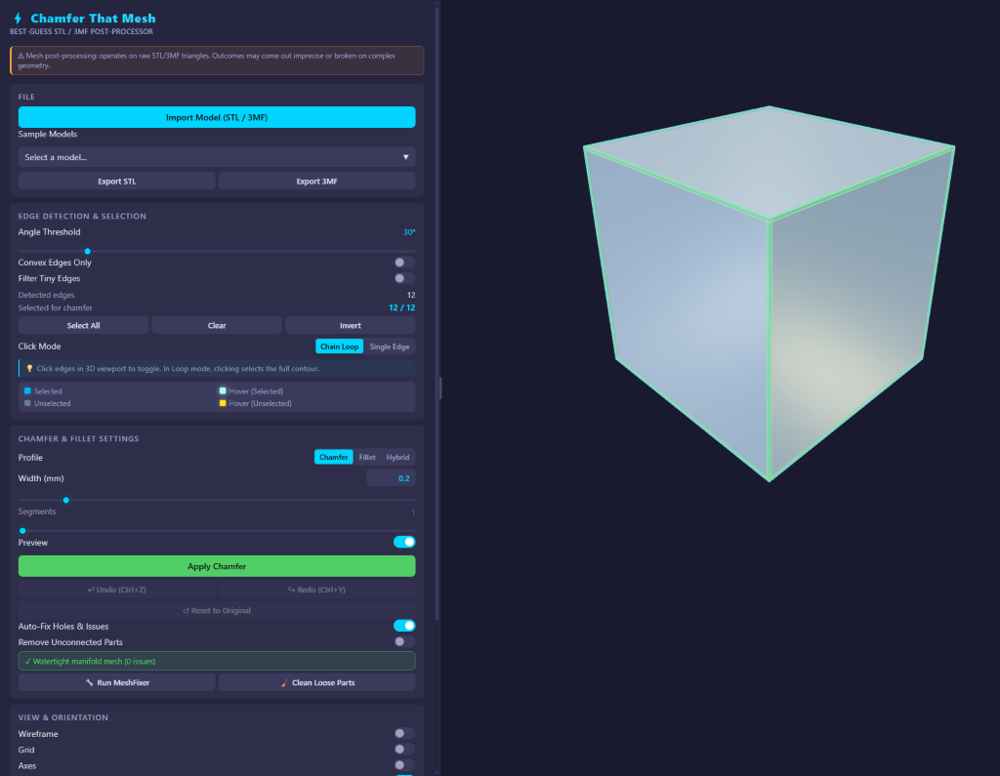

# Bevel Profiles & Engine

**Chamfer That Mesh** executes Constructive Solid Geometry (CSG) boolean subtractions on triangle boundary meshes. This guide explains the three bevel profiles, interactive preview ribbons, dimensional controls, and the CSG execution pipeline.

---

## 1. The Three Bevel Profiles

The studio provides three distinct edge geometry profiles:

```
    1. Flat Chamfer               2. Radial Fillet                 3. Hybrid Bevel
      ┌─────────┐                   ┌─────────┐                     ┌─────────┐
      │         │                   │         │                     │         │
      │         │                   │       ╭─┘                     │       /─┘ (curved shoulder)
      │       /─┘ (flat 45°)        │      (    (circular arc)      │      /    (flat center)
      │      /                      │     │                         │    ╭─┘    (curved shoulder)
      └─────┘                       └─────┘                         └────┘
```

### 1. Chamfer (Planar Break-Edge)
- **Geometry:** A flat, single-facet $45^\circ$ planar cut across the dihedral ridge.
- **Segments:** Fixed at 1 segment.
- **Best For:** 3D printing chamfers (eliminates elephant foot on build plates, avoids overhanging perimeter loops), mechanical deburring, and clean low-poly stylized models.
- **Performance:** Fastest CSG subtraction with minimal triangle count increase.



---

### 2. Fillet (Radial Circular Arc)
- **Geometry:** A cylindrical radial section that approximates an osculating circular radius tangent to both adjacent faces.
- **Segments:** Configurable between **2** and **16** segments (default is 7 segments). Higher segment counts produce silky-smooth highlights under PBR lighting.
- **Best For:** Ergonomic hand-held enclosures, aerodynamic surfaces, injection molding drafts, and organic industrial design.



---

### 3. Hybrid (Flat Center with Curved Transition Shoulders)
- **Geometry:** A wide planar center facet ($\tau = 0.26 \dots 0.74$ parameter space) flanked by tangent curved shoulder arcs transitioning seamlessly into the adjacent surfaces.
- **How it Works:** Standard fillets create a single continuous curve, while standard chamfers leave sharp $135^\circ$ crease lines at their borders. The Hybrid profile combines the structural strength of a wide flat bevel with soft, glare-free curved borders.
- **Best For:** CNC milling chamfer simulations, precision machined components, and high-spec industrial product renders.



---

## 2. Dimensional Controls & Range Auto-Expansion

The bevel width is controlled through synchronized numeric inputs:

- **Width (mm):** Set width down to $0.05\text{ mm}$ for fine mechanical parts or larger values for large furniture and architectural meshes.
- **Dynamic Slider Auto-Expansion:** If your model is large and you type a value higher than the current slider maximum (e.g., typing `15.0` when the slider max is `5.0`), the slider automatically scales its upper bound to accommodate the model.
- **Segment Slider:** Active when **Fillet** or **Hybrid** is selected. Allows dialling in smooth curves (recommended 6–8 segments for 3D printing).

---

## 3. Live 3D Preview Ribbons

Before modifying the underlying mesh vertices, turn on **Preview** to visualize the cutting envelope:



- **Translucent Emerald Overlay:** A semi-transparent green ribbon generates instantly along every selected edge loop.
- **Real-Time Responsiveness:** Adjusting the width slider or switching profiles updates the preview ribbon without running expensive boolean cuts.
- **Zero Destructive Risk:** Toggle preview on/off at will without modifying the mesh data or adding history entries.

---

## 4. CSG Boolean Subtraction Engine

When you click **Apply Chamfer**, the engine executes the following steps:

1. **Cutter Solid Construction:** For each selected edge loop, the engine sweeps a prism or curved cylinder along the edge tangent vector, calculating miter vertices at multi-edge corners.
2. **BVH Tree Building:** Both the subject mesh and cutter solids are compiled into Bounding Volume Hierarchy (BVH) spatial trees using `three-bvh-csg`.
3. **Boolean Subtraction:** The cutter volumes are subtracted ($A \setminus B$) from the original mesh, producing clean planar and curved cuts.
4. **Normal Recalculation:** Face and vertex normals are recomputed across newly cut facets to ensure crisp shading.
5. **Abort / Cancel Support:** For complex meshes with hundreds of edges, an in-progress operation can be stopped at any time by pressing **Esc** or clicking **Stop**. The engine cancels cleanly and rolls back to the intact previous state.
