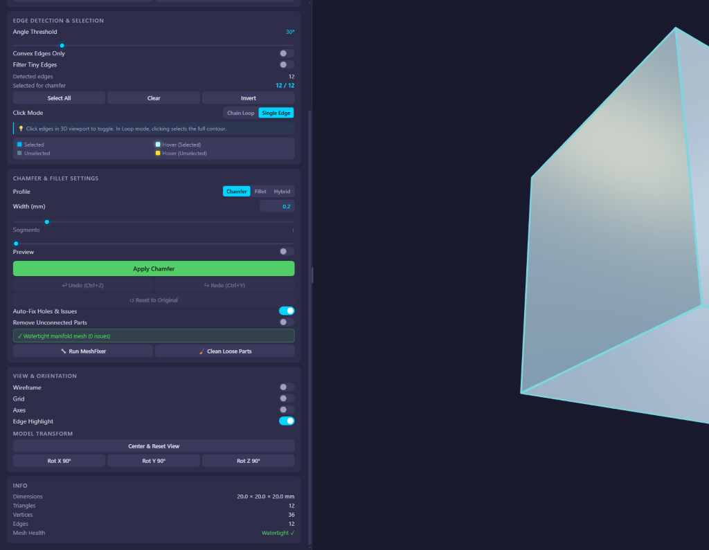

# Edge Detection & Selection

**Chamfer That Mesh** analyzes raw triangle meshes that lack CAD boundary representation (B-Rep) curves. It reconstructs geometric feature edges, computes surface curvature, and gives you interactive selection tools directly in the 3D viewport.

---

## 1. Sharp Edge Detection Pipeline

The detection engine parses the loaded triangle buffers into an indexed topological edge-adjacency structure:

1. **Topology & Adjacency Mapping:** Each triangle edge is hashed by its endpoints (with spatial tolerance $\epsilon \approx 10^{-5}$) to identify shared manifold boundaries.
2. **Dihedral Angle Calculation:** For each pair of adjacent faces with unit normals $\mathbf{n}_1$ and $\mathbf{n}_2$, the dihedral angle $\theta$ is calculated:
   $$\theta = \arccos(\mathbf{n}_1 \cdot \mathbf{n}_2)$$
3. **Threshold Filtering:** An edge is identified as a feature edge if its dihedral angle equals or exceeds the user-configured **Angle Threshold**.
4. **Convexity Classification:** Edges are classified as convex (exterior ridges) or concave (interior seams). By default, **Convex Edges Only** is enabled to prevent bevel cutters from carving into interior pockets.

```
                  Exterior Ridge
                   (Convex Edge)
                       /\
                      /  \
     Normal n1 <───  /    \  ───> Normal n2
                    /  θ   \
                   /────────\
```

---

## 2. Detection Parameters & Auto-Detection

| Parameter / Action | Default | Range / Type | Purpose |
|---|---|---|---|
| **Angle Threshold** | Model-optimized | `1°` to `180°` | Minimum angle between adjacent face normals required to register an edge. Lower angles detect soft curved boundaries; higher angles isolate sharp corners. |
| **✨ Auto Button** | One-Click | Action | Analyzes the model's geometry and automatically sets the optimal angle threshold, cleanly separating surface tessellation facets from intentional sharp edges. |
| **Convex Edges Only** | `Checked` | Boolean | Ignores concave / inner corner edges to ensure bevel subtraction cuts only along outer exterior rims. |
| **Filter Tiny Edges** | `Unchecked` | Boolean | Strips microscopic tessellation artifacts shorter than $0.2\text{ mm}$ or $0.5\%$ of bounding box size. |

### How Auto Angle Detection Works
If you are unsure what threshold to use or get lost adjusting the slider:
1. Click the minimal **`✨ Auto`** button directly beside the angle readout.
2. The engine analyzes the distribution of all dihedral angles across the mesh.
3. It detects the natural separation gap (or valley) between low-angle surface curvature facets (typically $< 25^\circ$) and intentional mechanical feature edges (typically $\ge 30^\circ - 90^\circ$).
4. The slider and display update instantly, edges are re-detected, and a confirmation toast displays the chosen threshold (e.g. `✨ Auto angle threshold: 28°`).
5. Auto-detection also runs automatically when importing a new 3D model or selecting a demo shape.

---

## 3. Selection Shortcuts & Interactive Modes



You can select edges using quick toolbar shortcut buttons, keyboard hotkeys, or direct 3D viewport picking:

### One-Click Selection Buttons & Hotkeys

| Action | Hotkey | Description |
|---|---|---|
| **Select All** | `A` or `Ctrl+A` | Marks all detected feature edges for chamfering. |
| **Clear** | `C` | Clears edge selection completely. |
| **Invert** | `I` | Flips the selection state across all detected feature edges. |
| **Horizontal** | `H` | Selects only edges parallel to the ground plane (e.g. flat face loops, concentric step tiers, gear top/bottom rims). |
| **Vertical** | `V` | Selects only edges perpendicular to the ground plane (e.g. upright wall corners, gear tooth vertical flanks). |
| **Top / Bottom** | `T` | Selects only the topmost and bottommost boundary loops of the model. |

### Viewport Picking (Click Mode)
- **Chain Loop Mode (Default):** Clicking any edge segment in the 3D viewport initiates an adjacency graph search along tangent-continuous neighbors. It automatically selects or deselects the entire continuous loop or perimeter contour.
- **Single Edge Mode:** Precise segment-by-segment toggling without following loops. Ideal for isolated chamfers or complex intersections.

---

## 4. Visual Color Legend

The studio uses high-visibility screen-space antialiased line overlays (`LineSegments2`) with distinctive color states:

| State | Color | Description |
|---|---|---|
| **Selected** | **Vivid Cyan-Blue** (`#00B4F5`) | Edges currently tagged to receive the bevel operation. |
| **Hover (Selected)** | **Ice-Cyan Highlight** (`#A0FFFF`) | Brighter glowing feedback when the mouse hovers over an already-selected edge, confirming click-to-deselect. |
| **Unselected** | **Slate Gray** (`#64748B`) | Detected feature edges that are currently excluded from beveling. |
| **Hover (Unselected)** | **Golden Amber** (`#F59E0B`) | Warm orange-yellow glow when hovering over an unselected edge, confirming click-to-select. |
