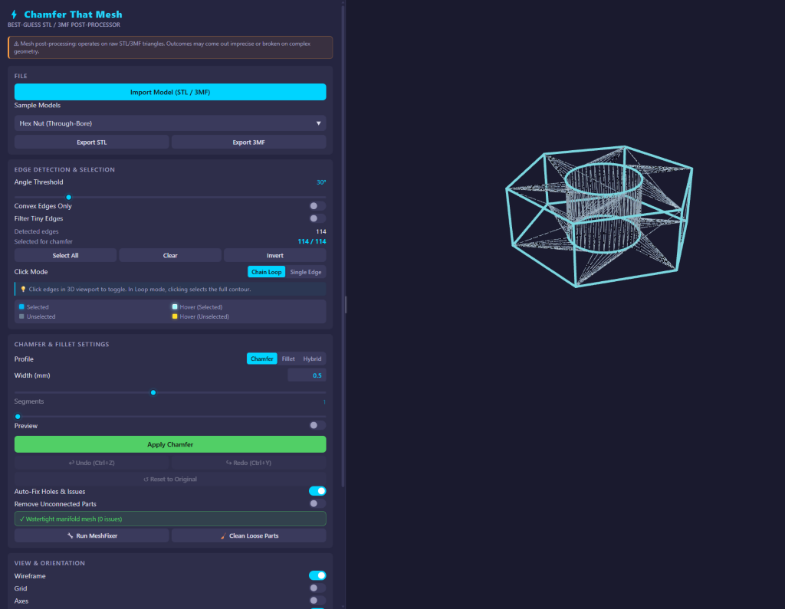
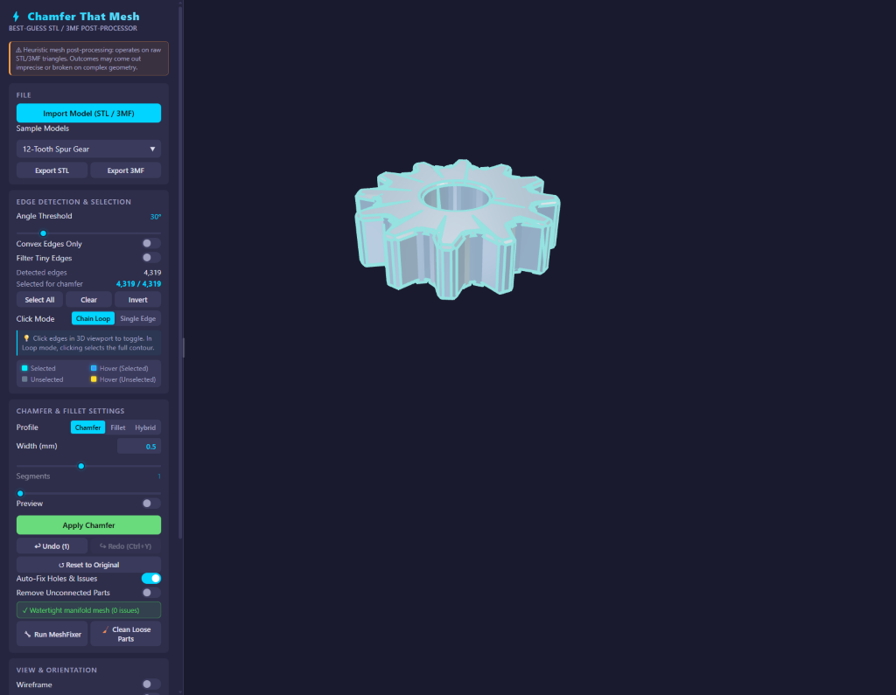

# File Formats & Sample Library

**Chamfer That Mesh** is designed for direct interoperability with 3D printers, CNC mills, and CAD packages. This guide covers supported file formats, unit scale fidelity, and the built-in library of sample models.

---

## 1. Supported File Formats & 1:1 Scale Fidelity

The studio handles the two standard exchange formats used in additive manufacturing:

```
               ┌───────────────────────────────┐
               │    Chamfer That Mesh Studio   │
               └───────┬───────────────┬───────┘
                       │               │
            Import / Export         Import / Export
                       ▼               ▼
                 Binary/ASCII STL    OPC 3MF Archive
```

### STL (.stl — Stereolithography)
- **Import:** Supports both binary and ASCII STL files. Automatically detects byte headers and parses triangle facet buffers.
- **Export:** Generates standard binary little-endian STL files compatible with all slicing engines (PrusaSlicer, Bambu Studio, OrcaSlicer, Cura, Simplify3D) and CAD software (Fusion 360, FreeCAD, Blender, SolidWorks).
- **Scale:** All coordinates are maintained at exact **1:1 millimeter ($1\text{ unit} = 1\text{ mm}$)** scale without unit inflation or re-scaling artifacts.

### 3MF (.3mf — 3D Manufacturing Format)
- **Import:** Parses the OPC ZIP container and reads the `/3D/3dmodel.model` XML payload using `fflate` and Three.js `ThreeMFLoader`.
- **Export:** Packages a fully compliant XML payload with standard namespaces, unit attributes (`unit="millimeter"`), and object definitions compressed into a compliant `.3mf` ZIP archive.
- **Advantages:** Smaller file sizes than STL, lossless unit scaling definitions, and direct drag-and-drop compatibility with modern dual-extrusion and high-speed multi-material slicers.

---

## 2. Built-in Demo Shapes

The sample library accessible from the sidebar dropdown provides 3 curated geometric models to explore features without needing to import external files:



| Model | Vertices / Triangles | Geometry & Testing Highlights |
|---|---|---|
| **Pyramid (Stepped)** | $48\text{ v} / 92\text{ f}$ | A 3-tier concentric architectural pyramid. Tests multi-level parallel horizontal loop selection and corner miter cuts. |
| **Hex Nut** | $96\text{ v} / 188\text{ f}$ | Standard M10 hex nut with 6 outer hexagonal flats and a through-bore hole. Tests compound planar/cylindrical edge looping. |
| **Tooth Gear** | $2'724\text{ v} / 908\text{ f}$ | Precision 12-tooth spur gear with central shaft bore and intricate tooth root/crest geometry. |



> [!TIP]
> To try chamfering intricate teeth, load the **Tooth Gear**, set **Angle Threshold** to `29°` or `30°`, keep **Convex Edges Only** checked, click **Preview** to verify the top/bottom rim ribbons, and click **Apply Chamfer**.
