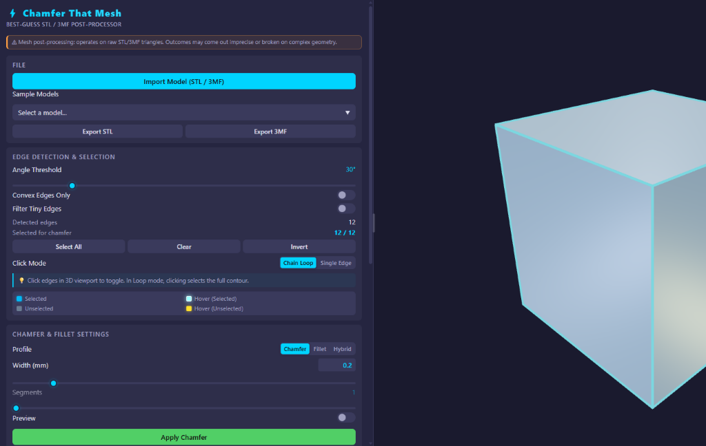
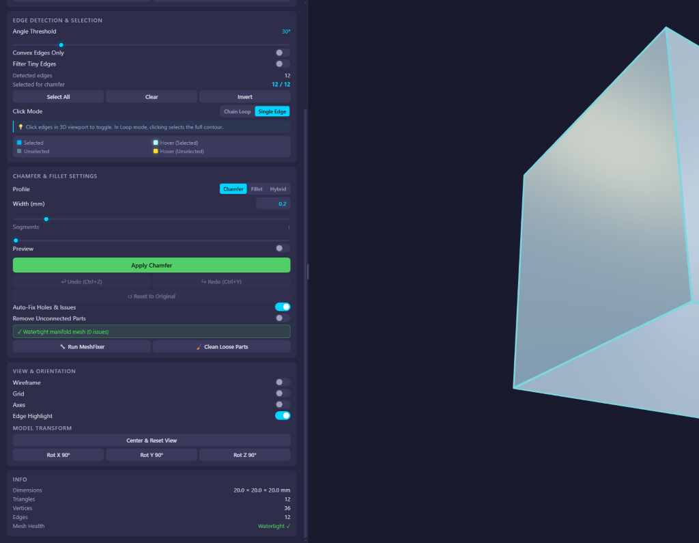
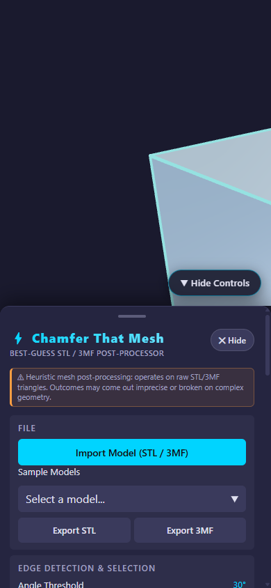

# UI Tour & Navigation

**Chamfer That Mesh** is structured as an interactive 3D studio optimized for both desktop workstations and mobile touch devices. This guide covers the interface layout, camera navigation, responsive panels, and viewport display helpers.

---

## 1. Studio Layout Overview

The application workspace consists of two primary regions:
1. **Interactive 3D Viewport (Right):** A full-screen WebGL canvas powered by Three.js with soft PBR studio lighting (`RoomEnvironment`), ground shadow grid, XYZ orientation gizmo, and interactive edge picking overlays.
2. **Settings & Operations Panel (Left):** A modular, scrollable sidebar grouping all edge detection parameters, selection controls, bevel profiles, mesh repair tools, model transformations, and file import/export actions.
3. **Status Bar & Quick Stats (Bottom):** Shows real-time bounding box dimensions ($X \times Y \times Z$ in millimeters), triangle counts, vertex counts, detected edge counts, and mesh health status.

---

## 2. CAD Turntable Orbit Navigation

Navigation uses intuitive CAD turntable orbit controls with inertial damping and mouse-pivot tracking, keeping upright orientation stable:

| Mouse / Gesture | Camera Action | Details |
|---|---|---|
| **Left-Click + Drag** | **Turntable Orbit** | Smoothly rotates around the CAD up-axis with cinematic damping without tumbling upside-down. |
| **Right-Click + Drag** | **Pan Viewplane** | Shifts the camera horizontally and vertically across the active screen plane. |
| **Scroll Wheel / Pinch** | **Zoom To Cursor** | Smooth exponential camera zoom directed precisely toward the mouse cursor or touch center. |
| **Left Click on Mesh** | **Set Rotation Center** | Automatically pivots subsequent camera rotation directly around the clicked surface vertex. |

> [!TIP]
> If the model ever rotates off-screen or out of sight, click **Center & Reset View** in the sidebar to re-center the bounding box and frame the geometry perfectly.

---

## 3. Desktop Resizable Sidebar

On desktop displays ($\ge 768\text{ px}$ width), the left settings panel can be interactively resized to fit your monitor resolution or personal workflow:

- **Interactive Drag:** Hover over the boundary between the sidebar and the 3D viewport until the `col-resize` cursor appears. Click and drag left or right to set any custom width between **280 px** and **800 px** (capped at 60% viewport width).
- **Double-Click Reset:** Double-click the vertical divider handle at any time to instantly restore the calculated default width.
- **Keyboard Stepping:** Focus the divider handle and press **Left Arrow** or **Right Arrow** to adjust panel width in precise 16-pixel increments.
- **Automatic Persistence:** Your chosen sidebar width is automatically saved to browser `localStorage` under `ctm_sidebar_width` and restored across page reloads.

---

## 4. Mobile Bottom-Sheet Drawer

When accessing Chamfer That Mesh on a smartphone or tablet screen ($< 768\text{ px}$ width), the interface transitions into a mobile-first bottom sheet drawer:

- **Uncluttered 3D View:** The 3D viewport expands to fill the entire mobile display (`100dvh`), eliminating mobile browser toolbar jumping.
- **Swipeable Bottom Sheet:** The settings panel docks at the bottom as a draggable drawer with an intuitive drag handle (`#drawer-handle`).
- **One-Tap Expansion:** Tap the drawer header to smoothly slide the panel up for adjusting bevel parameters or selecting samples; tap or drag down to minimize it back to the bottom.
- **Touch Edge Picking:** Directly tap highlighted edges on mobile screens to toggle selection, with an expanded touch hit-testing tolerance.

---

## 5. Viewport Display Helpers & Transforms

The **View & Orientation** section in the sidebar provides real-time toggles to inspect your mesh geometry:

| Control | Description |
|---|---|
| **Wireframe** | Overlays the underlying triangle topology with thin black edges, revealing how CSG boolean cuts subdivide the surface. |
| **Grid** | Toggles the ground plane millimeter grid beneath the model to gauge real-world scale. |
| **Axes** | Displays a 3D coordinate frame at the origin (Red = $+X$, Green = $+Y$, Blue = $+Z$). |
| **Edge Highlight** | Toggles visibility of the detected feature edge lines. Useful when evaluating the final smoothed surface. |
| **Center & Reset View** | Reframes the 3D camera to fit the bounding sphere of the active geometry. |
| **Rot X / Y / Z 90°** | Rotates the model 90 degrees around the selected principal axis. Fully integrated into the undo/redo history stack. |
